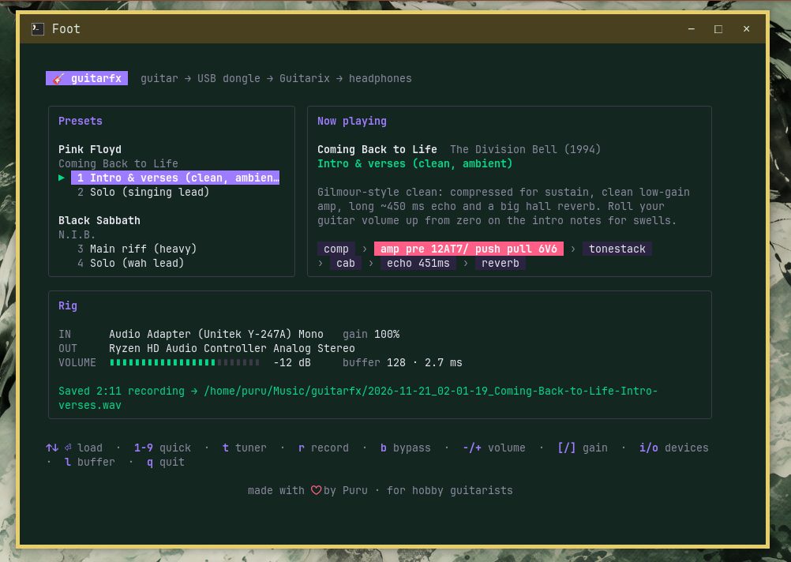

# lazyguitarist

**Lazy guitar effects for Linux.** Pick a song, plug in, play. No pedalboard, no patching, no fiddling with knobs.

I made this TUI on [Omarchy](https://omarchy.org) to help me play some of my favorite songs and solos without
setting up effects every time. Each song has a preset for each part (verse, solo, riff), and adding more songs is
just editing a JSON file.



## Demo

> 🎬 **Coming soon:** a demo video with voiceover.

<!-- Replace with the demo video link or embed, e.g. [](https://youtu.be/...) -->

## Features

- **Song presets.** Each part of a song gets its own effect chain, and switching parts (`2` for the Parts panel, then `j`/`k` and `Enter`) is instant, e.g.
  clean verse → solo. All presets are evened out to the same loudness, so switching never blasts your ears.
- **Tuner.** Standard tuning (E A D G B E). It tells you which string you're on and whether to **tighten** or
  **loosen** it, and by how much. The amp is muted while you tune, and 50/60 Hz cable hum is ignored.
- **Recording.** Press `r` to record exactly what you hear, and `r` again to stop. A blinking
  `● REC 0:12` shows while recording. Files are clean 48 kHz / 32-bit WAVs with click-free fades, saved in
  `~/Music/lazyguitarist/`.
- **Low latency.** It runs PipeWire at a 128-sample buffer (2.7 ms), so playing feels instant through wired
  headphones. Quitting puts the buffer setting back.
- **Add any song.** Type `/preset <song>` in Claude Code and it researches the tone and adds the preset. Or edit
  `presets.json` by hand, with built-in checks.
- **Zero setup.** It finds your USB guitar dongle, wires everything with PipeWire and starts the
  [Guitarix](https://guitarix.org) engine in the background with no window. You just see the TUI.

### Included presets

| # | Song | Part | Chain |
|---|---|---|---|
| 1 | Pink Floyd - *Coming Back to Life* | Intro & verses | compressor › clean amp › Twin tonestack › 4x12 › 450 ms echo › hall reverb |
| 2 | | Solo | gate › compressor › TS9 › pushed amp › 4x12 › 450 ms echo › reverb |
| 1 | Black Sabbath - *N.I.B.* | Main riff | gate › Rangemaster treble booster › high-gain amp (JCM-800 tonestack, mids up) › 4x12 › room |
| 2 | | Solo | same + auto-wah |
| 1 | Guns N' Roses - *Sweet Child O' Mine* | Intro riff | gate › medium-gain Marshall (JCM-800 tonestack) › 4x12 › plate-style reverb |
| 2 | | Solo | gate › TS9 › pushed Marshall › 4x12 › reverb |
| 3 | | Outro solo | gate › auto-wah › TS9 › pushed Marshall (mids up) › 4x12 › reverb |
| 1 | Albatross - *Nischal* | Intro (soft clean) | compressor › warm clean amp › 1x12 › quarter-note echo (161 BPM) › reverb |
| 2 | | Intro (electric lead) | gate › compressor › light TS9 › clean-edge amp › 2x12 › quarter-note echo (161 BPM) › reverb |
| 3 | | Main riff | gate › light TS9 › high-gain amp (Mesa Boogie tonestack) › 4x12 › room |
| 4 | | Solo | gate › TS9 › pushed amp (strong mids) › 4x12 › quarter-note echo (161 BPM) › reverb |
| 1 | Albatross - *Timi Bhane* | Intro | gate › light TS9 › lightly driven amp (JCM-800, mids up) › 2x12 › ~630 ms echo › reverb |
| 2 | | Verse | compressor › soft clean amp (Fender tonestack) › 2x12 › faint quarter-note echo (147 BPM) › room |
| 3 | | Chorus | gate › light TS9 › high-gain amp (Mesa Boogie tonestack) › 4x12 › room |
| 4 | | Solo | gate › TS9 › pushed amp (strong mids) › 4x12 › quarter-note echo (147 BPM) › reverb |

These are by-ear approximations built from Guitarix's amp and pedal models, not copies of the original rigs.

## How it works

```
Fender ──► USB dongle (mic in) ──► Guitarix (headless) ──► headphones (wired)
                                        ▲
                     lazyguitarist TUI ──────┘  JSON-RPC: presets, tuner, volume
                     PipeWire (pw-link)    wiring + 128-sample buffer
                     pw-record             recording
```

## Prerequisites

| What | Arch / Omarchy package | Why |
|---|---|---|
| Guitarix | `guitarix` | the amp/effects engine |
| PipeWire + JACK support | `pipewire`, `pipewire-jack` | audio, and lets Guitarix run as a JACK app (no `jackd` needed) |
| PipeWire tools | `pipewire-audio` (`pw-record`), `pipewire-pulse` + `libpulse` (`pactl`) | recording, device list, input gain |
| WirePlumber | `wireplumber` | PipeWire session manager (Omarchy default) |
| Go 1.24+ | `go` (or via `mise`) | to build it |

```bash
sudo pacman -S --needed guitarix pipewire pipewire-jack pipewire-audio pipewire-pulse wireplumber go
```

Omarchy already ships PipeWire, WirePlumber and pipewire-pulse, so on Omarchy it's mostly `guitarix` and `go`.
You don't need `jackd`, a `realtime` group or any extra drivers: PipeWire gets realtime priority through RTKit, and
USB audio dongles use the kernel's standard `snd-usb-audio` driver.

## Install & run

```bash
git clone https://github.com/tuladhar/lazyguitarist.git
cd lazyguitarist
go build -o lazyguitarist .
ln -s "$PWD/lazyguitarist" ~/.local/bin/lazyguitarist   # optional: run it from anywhere

lazyguitarist            # preset menu
lazyguitarist --tuner    # open straight into the tuner
lazyguitarist --check    # list audio devices and what lazyguitarist would use
lazyguitarist --version  # the version (also bottom right in the app; click it to open the commit or release)
```

### Keys

| Key | Action |
|---|---|
| `1` / `2` / `3` / `0` | focus the Songs / Parts / Rig / main panel (like lazygit) |
| `Tab`, `←`/`→` or `h`/`l` | next / previous panel |
| `↑`/`↓` or `j`/`k` | move in the focused panel |
| `Enter` / `Space` | play the part under the cursor (in Songs: open or fold an artist; in Rig: change the setting) |
| `/` | search songs, artists and parts as you type (`Enter` keeps the filter, `Esc` clears it) |
| `t` | tuner, inside the main panel (any key goes back) |
| `r` | start / stop recording (`● REC` shows bottom right) |
| `b` | bypass all effects (dry guitar) |
| `-` / `+` | output volume (starts at -12 dB); in Rig, change the setting under the cursor (e.g. input `GAIN`) |
| `i` / `o` | switch input / output device |
| `L` | buffer size 64 / 128 / 256 (lower = less latency, more risk of crackles) |
| `a` | about: version, commit, author and GitHub link (clickable) |
| `?` | list every key |
| `q` | quit |

The screen is laid out like lazygit and fills the terminal: **Songs**, **Parts** and **Rig** on the left, the
part's details (or the tuner) and a **Log** of what happened on the right, and the keys along the bottom.
Songs is a tree grouped by artist (A–Z); artists stay folded until you open one with `Enter`, and `/` finds a
song, artist or part as the list grows.

## My setup (known good)

| | |
|---|---|
| OS | Omarchy 4.5.0 (Arch Linux), kernel `7.2.15-1-omarchy` |
| Audio | PipeWire 1.6.9, WirePlumber 0.5.18, pipewire-jack 1.6.9, 48 kHz |
| Engine | Guitarix 0.47.0 |
| Guitar | Fender electric |
| USB dongle | Unitek Y-247A USB audio adapter (C-Media chip, `snd-usb-audio` driver). The guitar goes into its **mic input** (6.35 mm → 3.5 mm adapter). Mono, 48 kHz. |
| Headphones | Sony, wired, into the **laptop's 3.5 mm headphone jack** (Ryzen HD Audio, `snd_hda_intel`). Wired on purpose: Bluetooth adds far too much delay for playing live. |
| Terminal | Foot |

### Preferred settings

- **Buffer:** 128 samples @ 48 kHz (`l` to change). lazyguitarist sets it with
  `pw-metadata -n settings 0 clock.force-quantum 128` while it runs and restores it on quit.
- **Output:** the wired headphone jack (`o` to pick). Plugging the headphones into the dongle itself saves another
  ~1–2 ms, because input and output then share one clock.
- **Input gain:** start at 100% (the most it goes) and lower it in the Rig panel (`3`, `j` to `GAIN`, `-`) if clean tones distort or high-gain sounds
  fizzy. Mic inputs are hot: on a laptop's mic jack the hardware boost only starts dropping below 100%, so try 50–75%.
  For more gain, raise the preset's amp `pregain` instead.
- **Volume:** start at -12 dB with the headphones off your ears, then bring it up.
- **Firewall:** keep `ufw` on (Omarchy's default). Guitarix's control port has no password and listens on all
  interfaces while lazyguitarist runs, and ufw blocks it from the network.
- **Avoid 16 kHz "mic" dongles:** some USB receivers only do 16 kHz, which sounds like a phone call.
  `lazyguitarist --check` shows each device's sample rate. You want 44.1 or 48 kHz.

## Adding songs

### The easy way: `/preset` (Claude Code)

This repo ships a [Claude Code](https://claude.com/claude-code) skill. Open Claude Code in the repo and type:

```
/preset Comfortably Numb
/preset Iron Man - Black Sabbath
/preset Hotel California solo
/preset Enter Sandman
```

It looks up how the guitarist got the tone on that recording (amp, pedals, delay time from the song's tempo),
builds parts like "Main riff" and "Solo" from lazyguitarist's effects, checks every setting against Guitarix, matches
the loudness to your other presets, and adds the song to the README table. Restart `lazyguitarist`, pick the song in Songs and
its parts in Parts. Not quite right? Just say "darker", "more gain" or "less echo".

**Works best with the original song.** Give the path to an MP3 of the recording and the skill learns from it:
tempo (so echoes land on the beat), tuning and key, where the intro, verse, chorus and solo are, and how bright,
dark or distorted each one is. Without it, the preset is built from web research alone, which for many bands
(especially smaller or local ones) has little to go on.

```
/preset Timi Bhane by Albatross ~/Downloads/Timi Bhane.mp3
```

The skill lives in [`.claude/skills/preset/SKILL.md`](.claude/skills/preset/SKILL.md).

### By hand

Presets live in `presets.json`. lazyguitarist reads `~/.config/lazyguitarist/presets.json` first, then the one next to the
binary, then the copy built into the binary. Each part looks like this:

```json
{
  "name": "Solo (singing lead)",
  "description": "Shown in the Now playing panel.",
  "level_db": 9.7,
  "guitar": { "pickup": "bridge", "volume": 10, "tone1": 10, "tone2": 7 },
  "amp": { "model": "pre 12AT7/ push pull 6V6", "pregain": 0, "drive": -4 },
  "fx": {
    "compressor": { "ratio": 5, "threshold": -28 },
    "ts9sim":     { "drive": 0.45, "tone": 550, "level": -10 },
    "cab":        { "select": "4x12" },
    "echo":       { "bpm": 133, "percent": 32 },
    "zita_rev1":  { "output.dry_wet_mix": -0.45 }
  }
}
```

- **`amp`**: `model` is a Guitarix tube model (`12ax7`, `12AU7`, `6V6`, `pre 12ax7/ push-pull 6V6`, …);
  `pregain` and `drive` are -20..20 dB.
- **`fx`**: effects to turn on, with Guitarix settings. Anything not listed is off. Available: `abgate` (noise gate, threshold in dB),
  `crybaby` (wah), `compressor`, `rangem` (treble booster), `ts9sim` (Tube Screamer), `muff` (Big Muff) before the
  amp; `amp.tonestack`, `cab`, `echo` after it; `zita_rev1` reverb.
- **`echo.bpm`** sets the echo time: one repeat every 60000/bpm ms (133 ≈ 451 ms; dotted eighth = tempo / 0.75).
- **`level_db`** evens out loudness between parts (-40..40 dB).
- **`guitar`** (optional) is shown under the chain: how to set a Strat-style guitar. `pickup` is the 5-way
  selector (`bridge`, `bridge+middle`, `middle`, `middle+neck`, `neck`); `volume`, `tone1` (neck) and `tone2`
  (middle/bridge) are knob numbers 0..10.

Three helper commands make editing easy. Each runs a hidden Guitarix instance that never makes sound, so they're
safe while you play:

```bash
./lazyguitarist --params units            # which effects exist
./lazyguitarist --params ts9sim           # an effect's settings, ranges and options (also: amp, cab, …)
./lazyguitarist --validate                # check every preset: wrong names, out-of-range values, bad options
./lazyguitarist --calibrate "numb"        # suggest level_db so the song is as loud as the rest
```

Even without `--validate`, typos are safe: unknown effects or settings are skipped and shown in red instead of
being sent to Guitarix.

## Files

| Path | What |
|---|---|
| `~/.config/lazyguitarist/config.json` | chosen devices, volume, buffer, last preset |
| `~/Music/lazyguitarist/` | recordings |
| `~/.cache/lazyguitarist/guitarix.log` | Guitarix engine log |
| `~/.config/guitarix/lazyguitarist_rc` | Guitarix's state for this instance (your normal Guitarix settings are untouched) |

If lazyguitarist is ever killed with `kill -9`, restore PipeWire's buffer with
`pw-metadata -n settings 0 clock.force-quantum 0`.

## Built with

[Guitarix](https://guitarix.org) · [PipeWire](https://pipewire.org) · [Bubble Tea](https://github.com/charmbracelet/bubbletea) and [Lip Gloss](https://github.com/charmbracelet/lipgloss) by [Charm](https://charm.land)

## License

[MIT](LICENSE)

---

<p align="center">made with ♥ by Puru · for hobby guitarists</p>
